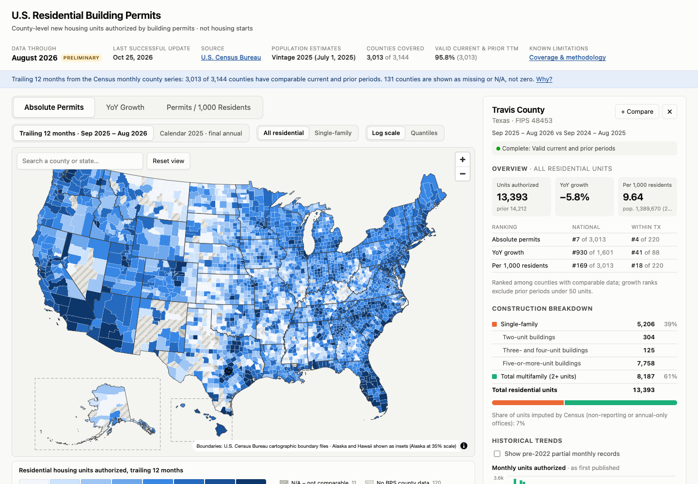

# U.S. Residential Building Permits Dashboard

An interactive county-level map of new residential housing units authorized by building
permits, built entirely from official U.S. Census Bureau data and refreshed automatically
when Census publishes new or revised files. It is meant for market research: finding
counties with high and fast-growing residential construction.



**What it shows (for each of 3,144 counties and county equivalents):**

* **Absolute permits**: housing units authorized in the trailing 12 months
* **YoY growth**: trailing 12 months vs the preceding 12 months
* **Permits per 1,000 residents**: trailing units / official population × 1,000
* **Land Opportunity Score** (0–100): a screening index for land-flipping research. It is a
  weighted average of national percentiles for permit volume, YoY momentum, 3-year permit
  growth, 3-year population growth and permits per resident. The weights are adjustable in
  the dashboard ([methodology](docs/METHODOLOGY.md#8-land-opportunity-score)).

Each metric has a **single-family** variant. There is also a **calendar-year view** built
from Census's finalized annual county file. The dashboard includes hover tooltips,
county profiles (construction breakdown, rankings, monthly / TTM / YoY / annual history),
state and county search, filters, a sortable rankings table with CSV export, side-by-side
comparison of up to five counties, and a methodology panel with the live validation report.

> These are **building permits**, not housing starts. Census does not publish starts by county.

## Key findings about the data (read before using it)

* **Comparable monthly county data exist only from January 2022.** Earlier county monthly
  files covered only Census's monthly sample (about 71% of U.S. units on average) and are
  shown as *partial* history. Comparable trailing totals start in December 2022, and YoY
  growth in December 2023.
* **Not every county can have a trailing-12-month value.** For Sep 2025–Aug 2026,
  3,013 of 3,144 counties (95.8%) have valid current and prior values. 120 counties have
  no permit-issuing jurisdiction in the Census county files, which means missing data,
  not zero. Seven appear only in the annual file and four are not computable. All are
  shown distinctly on the map.
* **Monthly and final annual county figures are different estimates** and differ in most
  counties. They are never mixed in one calculation.
* Statewide permit offices (e.g. New Mexico's, with 2,704 units in the current window)
  cannot be attributed to a county. They are excluded from county figures and disclosed.
* Trailing totals use a **revision-consistent YTD method** so late reports are counted exactly once.

Details, formulas and evidence: **[docs/METHODOLOGY.md](docs/METHODOLOGY.md)**.

## Quick start (local)

Requirements: Python 3.11+, `curl`, and macOS or Linux. Node.js is installed into the project by the setup script.

```bash
make setup      # .venv + pinned Python deps, Node 22 in .tools/node, npm packages, Playwright browser
make dev        # rebuild public/data from the committed raw files, then serve on http://localhost:5173
```

Other targets: `make refresh` (check Census for new data), `make test` (pytest + vitest),
`make e2e` (browser tests on the production build), `make build` / `make preview` (static
site in `dist/`), `make validate`, and `make status`.

The committed `data/raw` already contains every Census file used, so `make dev` works
offline. `make refresh` downloads only what is new or changed.

## Deploying (GitHub Pages, free)

1. Create an empty GitHub repository and push this one:
   ```bash
   git add -A && git commit -m "Residential building permits dashboard"
   git remote add origin git@github.com:<you>/<repo>.git && git push -u origin main
   ```
2. **Settings → Pages → Build and deployment → Source: GitHub Actions.**
3. **Settings → Actions → General → Workflow permissions: Read and write.** The refresh
   job commits new raw files.
4. The push triggers **Build and deploy dashboard**. The site appears at
   `https://<you>.github.io/<repo>/`.

The site is fully static. It needs no database, no API keys and no map token: the map draws
Census boundaries with MapLibre and no third-party tiles. The build uses a relative base
path, so the same `dist/` also works on **Cloudflare Pages** (build command
`make setup && make build`, output `dist`) or any static host. With Cloudflare, keep
`refresh-data.yml` for updates and let Cloudflare deploy on each push.

## Automatic monthly refresh

`.github/workflows/refresh-data.yml` runs **daily**, because Census release dates shift. It:

1. reads the live Census directory listings (county files, state files, population vintages, boundaries);
2. compares them with `data/raw/manifest.json` and downloads new or revised files (verified by SHA-256);
3. exits successfully, changing nothing, when there is nothing new;
4. otherwise rebuilds all periods from raw files, runs 23 data-quality checks, and runs the tests;
5. only if everything passes, commits the raw files, manifest and release record, then deploys.

Any failure (download, schema change, validation) fails the job, which GitHub reports by
email. Nothing is committed and the live site keeps the last good dataset.
**Manual refresh:** Actions → *Refresh Census data* → *Run workflow* (options: `force`,
`backfill_from`). New PEP population vintages are picked up the same way, and older
vintages are kept.

Runbook for failures, backfills and Census format changes: **[docs/OPERATIONS.md](docs/OPERATIONS.md)**.

## Repository layout

```
scripts/bpsdash/      Python pipeline: sources (discovery/download/manifest), permits (BPS parser),
                      population (PEP), geography (boundaries → composite projection), metrics (TTM/YoY/
                      per-capita), build, validate, refresh (orchestration, releases, logs), CLI
src/                  React + TypeScript dashboard (MapLibre GL map, Recharts charts)
data/raw/             Census source files exactly as downloaded (gzip) + manifest.json (provenance)
data/geography/       Census cartographic boundary files
data/releases/        Release index and per-version snapshots
data/logs/            Refresh log
data/processed/       Parquet outputs (generated)
public/data/          Web artifacts (generated)
tests/python|web|e2e  pytest (synthetic fixtures + hand-checked real values), vitest, Playwright
.github/workflows/    refresh-data.yml (daily refresh), deploy.yml (build, test, deploy)
docs/                 Methodology, operations runbook, data dictionary
```

## Technical decisions

* **Python + pandas/NumPy pipeline, Parquet + JSON outputs.** Parquet is for analysis and
  audit; compact columnar JSON is for the browser. Per-state history files load on demand.
* **Raw files committed (27 MB gzipped).** Every published number can be reproduced from
  the exact bytes Census served, even if Census later changes a file. Builds are
  deterministic: an offline rebuild is byte-identical to the published release.
* **MapLibre GL with GeoJSON and `feature-state` coloring.** Switching metrics, units,
  scaling or filters repaints the same polygons instantly with no data reload.
* **Composite equal-area projection with Alaska and Hawaii insets**, pre-projected in the pipeline.
* **Data-driven legend breaks.** Breaks are computed from the counties currently shown;
  nothing is hand-picked. Colors use validated ramps (blue for counts, violet for rates,
  red/neutral/green for growth, with a color-vision-friendly option).
* **No browser "refresh" button.** Refreshes happen only server-side.
* **Node installed project-locally** (`scripts/setup-node.sh`). Python dependencies are pinned in `requirements.txt`.

## Sources and citations

* U.S. Census Bureau, *Building Permits Survey*, county and state files,
  <https://www2.census.gov/econ/bps/>. Methodology:
  <https://www.census.gov/construction/bps/methodology.html>. Release schedule:
  <https://www.census.gov/construction/bps/schedule.html>.
* U.S. Census Bureau, *Population Estimates Program*, county totals, Vintage 2025,
  <https://www2.census.gov/programs-surveys/popest/datasets/2020-2025/counties/totals/>.
* U.S. Census Bureau, *Cartographic Boundary Files*, 2025, 1:5,000,000 counties and states,
  <https://www.census.gov/geographies/mapping-files/time-series/geo/carto-boundary-file.html>.

This product uses Census Bureau data but is not endorsed or certified by the Census Bureau.

## Testing

* `make test-py`: 41 pytest tests. They cover the parser and schema-change rejection;
  missing vs zero; TTM math, including revision handling; YoY and per-capita edge cases;
  download hardening; raw-store transactions; and an end-to-end build on the committed
  data, with values derived by hand from raw Census rows.
* `make test-web`: 19 vitest tests on scales, legends, filters, sorting, CSV and search.
* `make e2e`: 6 Playwright tests on the production build with real data. They cover the
  map, metric toggles without reload, search and county detail, map click, table
  selection, CSV download, missing-data legend, methodology, and comparison.

Documentation: [METHODOLOGY](docs/METHODOLOGY.md) · [OPERATIONS](docs/OPERATIONS.md) · [DATA DICTIONARY](docs/DATA_DICTIONARY.md)
